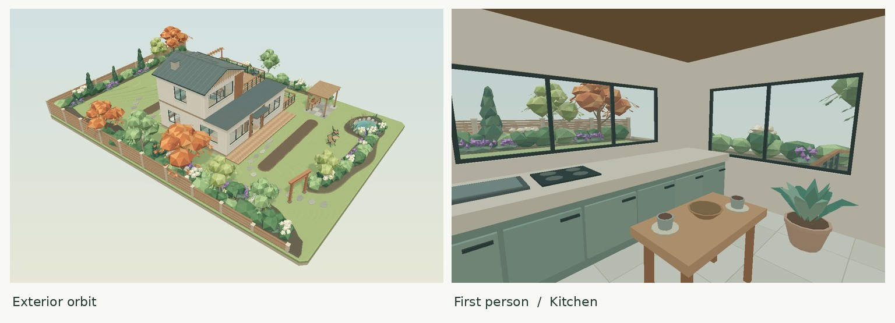
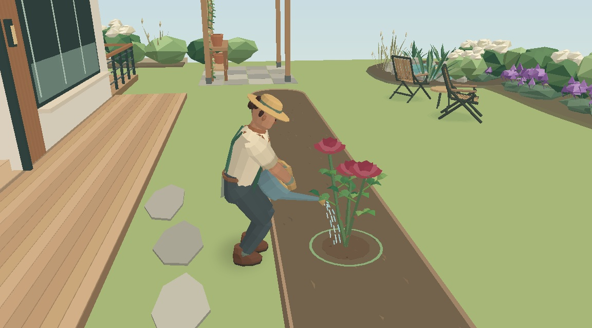
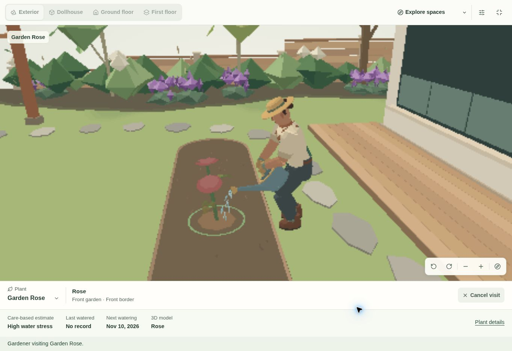

# Sproutly Living Home

Home opens the same plants, routines and care history as the rest of Sproutly. A Rose assigned to the front garden grows in its soil. An Aloe assigned to the kitchen countertop sits in a pot above the cabinetry. Choose **Dollhouse** to see plants on both floors and outdoors together.



## Run it

Use Node.js 22 or later. Unzip the complete project and run these commands in its `sproutly` directory. If you already have the previous Walk as Gardener release at `bfd596b`, apply `Sproutly-Architectural-Upgrade.patch` with `git apply` at that checkout’s root. For the original GitHub revision `7812700`, use `Sproutly-Living-Home.patch` instead. Either patch can be checked first with `git apply --check`.

```sh
npm ci
npm run dev
```

Open `http://localhost:3000/demo/home`. The local demo uses the existing Sproutly sample garden and saves your changes in this browser. Try **Add plant**, enter “Garden Rose,” set the common name to “Rose,” and choose **Front garden**. Give it a watering routine to see the next due date. Select **Water**, watch the visit, then open **History**.

For signed-in gardens, copy `.env.example` to `.env.local` and configure the public Supabase URL and publishable key plus the server-only Prisma database URLs. Apply the project’s outstanding SQL migrations through `005_living_home.sql` and use `/home`. The README covers Supabase Auth, role grants and connection setup. A production build runs with `npm run build` followed by `npm start`.

## Explore and take care of a plant

| Control                     | What it does                                                                                                                                                                                                          |
| --------------------------- | --------------------------------------------------------------------------------------------------------------------------------------------------------------------------------------------------------------------- |
| Exterior                    | Fits the entire plot, house, patio and landscaped garden. Rooms behind solid walls can be opened using the location or plant picker.                                                                                  |
| Dollhouse                   | Removes the exterior roof and front-facing architecture to reveal both floors, furniture and planted locations.                                                                                                       |
| Ground floor / First floor  | Isolates a storey. The upper studio and roof terrace connect to the ground floor by stairs.                                                                                                                           |
| Explore spaces              | Frames a room or enters free exploration. Drag to orbit, right-drag or use two fingers to pan, and pinch or scroll to zoom. With the canvas focused, arrow keys orbit, WASD pans, Q/E changes height and Home refits. |
| Plant                       | Select by name or tap the model. The panel gives the recorded species, model, location, care estimate, last watering and next scheduled watering. Group approximations are labelled.                                  |
| Move plant                  | Choose a room and a named spot, or tap a valid surface. Save the placement. A full surface prompts for another location.                                                                                              |
| Water / More care / Inspect | Follow the gardener in the scene. The watering can, fertilizer, pruning shears, sprayer and inspection poses are modeled independently. Inspection reads the plant’s available information.                           |
| Fullscreen                  | Keeps the plant picker, care actions and floor controls available. Exit with the same control or Escape. Devices without the browser fullscreen API use an expanded layout.                                           |

### Walk as gardener

Press **C** inside the viewer or choose **Walk as gardener**. The first-person view starts on the front lawn facing the front door. Selecting a plant first starts you beside its saved location. The camera selector also offers **Fly** and **Follow gardener**. Returning with **C** or **Back to map** restores your exterior framing.

| Control                              | First person and Fly                                                                                                                     |
| ------------------------------------ | ---------------------------------------------------------------------------------------------------------------------------------------- |
| WASD, arrow keys or movement pad     | Move forward, back or sideways. Hold Shift on a keyboard to sprint.                                                                      |
| Click the scene, then move the mouse | Look freely. Escape or Tab releases the mouse. Touch and browsers that decline capture support drag-to-look. J/L turn with the keyboard. |
| Q and E or Space                     | In Fly, Q descends and E or Space rises. Touch users have up and down buttons.                                                           |
| E, F or Tend                         | On foot, select a plant within reach. Choose Water, Fertilize, Prune, Mist or Inspect from the available actions.                        |
| Follow gardener                      | See the character from behind. Drag to orbit them, pinch or scroll to adjust distance and use Home to recenter.                          |
| C or Back to map                     | Switch to the exterior orbit. Drag to rotate, right-drag to pan and scroll or pinch to zoom.                                             |

The walking eye stays 1.65 m above the lawn, patio, stairs or finished floor. The player accelerates and brakes in metres per second. Small time steps prevent tunnelling during a slow frame. Look smoothing operates on angles so it cannot pull the eye through a door jamb. Fly uses a 16 cm collision radius against rendered surfaces, including windows and ceilings. Returning to walking grounds you under the flight camera when there is a clear landing. Above a roof or obstructed bed, you resume at your previous walking position.

Care works on foot. The camera briefly frames the gardener and the chosen plant together while the existing care action runs. You regain control at the same place. On mobile, the movement pad and look gestures work together in fullscreen.

### Architectural dimensions and geometry

One world unit equals one metre. The saved plant coordinates retain their existing origin. The exported model is centred around the house for editing.

| Element          | Finished dimension                                                                                                   |
| ---------------- | -------------------------------------------------------------------------------------------------------------------- |
| House and site   | 10 × 8.5 m footprint centred on a 22 × 31.5 m lot. Side clearances are 6 m and front and rear clearances are 11.5 m. |
| Grade and floors | Lawn at 0 m, raised soil at 0.06 m, patio at 0.105 m. Finished floors at 0.18 and 3.18 m.                            |
| Walls and doors  | 2.82 m walls, 14 cm exterior wall thickness and 2.10 m clear door height.                                            |
| Windows          | Typical sill at 0.85 m, countertop sill at 1.12 m, window heads at 2.20 m above the storey.                          |
| Circulation      | 1.20 m of central passage beside the kitchen and a 1 m stair flight with 15 rises.                                   |
| Lenses           | 40° vertical field of view in exterior orbit and 66° at eye level.                                                   |

Edit dimensions and openings in `lib/estate/plan.ts`. The wall generator in `envelope.ts` merges adjacent volumes and emits their exposed faces once. It uses the same dimensions as the walking plan. Floor finishes leave openings for stairs. The window frames surround transparent, two-sided panes that keep light and sightlines open to the garden. The renderer draws the panes after opaque furniture and moving characters. The ground and porch finishes use separate surfaces to avoid flicker.





## Architecture and changed files

The app uses Next.js 16.4.6 App Router, React 19.3.1, TypeScript and server actions. The scene uses direct WebGL 1 with a depth-tested Canvas 2D fallback. Its React component loads on demand. The control and geometry changes share the existing renderer and plant records. Supabase Auth supplies the verified user. Prisma accesses PostgreSQL with the authenticated role and row-level policies. Supabase Storage holds private photos. The dashboard, Tasks, Calendar, History, Growth, Weather, notifications and administration share a workspace provider. The new Home and Analytics destinations use that provider.

| Area                     | Implementation                                                                                                                                                                                                                                                          |
| ------------------------ | ----------------------------------------------------------------------------------------------------------------------------------------------------------------------------------------------------------------------------------------------------------------------- |
| Workspace and controls   | `components/workspace.tsx`, `home.tsx`, `estate-viewer.tsx`, `home.css`, `plant-form.tsx`, `views.tsx`, `tasks.tsx`, `use-estate-care.ts`, `care-analytics.tsx`                                                                                                         |
| Home, garden and cameras | `lib/estate/plan.ts`, `envelope.ts`, `layout.ts`, `buildings.ts`, `landscape.ts`, `mesh.ts`, `player.ts`, `first-person.ts`, `pointer-look.ts`, `renderer.ts`, `explorer.ts`                                                                                            |
| Species, health, visits  | `lib/estate/garden.ts`, `specimens.ts`, `health.ts`, `navigation.ts`, `gardener.ts`, `care.ts`, and `lib/home-care.ts`                                                                                                                                                  |
| Placement and storage    | `lib/home.ts`, `lib/home-records.ts`, `lib/server/plant-home.ts`, `app/actions.ts`, Prisma schema and SQL migrations 003–005                                                                                                                                            |
| Synchronization          | `components/garden-provider.tsx`, `lib/workspace-sync.ts`, `lib/server/repository.ts`, `lib/demo.ts`, `lib/demo-store.ts`                                                                                                                                               |
| Model export and checks  | `scripts/export-home.ts`, `scripts/benchmark-walk.ts`, `tests/architectural-explorer.test.ts`, `tests/estate*.ts`, `tests/estate-browser.mjs`, `tests/gardener.test.ts`, `tests/specimens-health.test.ts`, `tests/demo-sync.test.ts`, existing Home and database suites |

**Plant placement.** The existing plant ID identifies the model. A location string resolves to a stable room ID and integer surface coordinates. World height comes from the modeled support. Furniture, circulation space and nearby plants exclude unsafe spots. The signed-in allocator serializes changes per owner. Legacy plants keep valid saved positions where possible. If a legacy collection exceeds all available surfaces, excess records remain available in the picker for reassignment. Archiving removes a model. Restoring reuses its position when available.

| Outdoors                      | Ground floor                                                                                                       | First floor                   |
| ----------------------------- | ------------------------------------------------------------------------------------------------------------------ | ----------------------------- |
| Front garden, backyard, patio | Living room, bedroom, kitchen, kitchen countertop, home office, balcony, hallway, indoor plant shelf, window ledge | Upstairs studio, roof terrace |

**Health.** “Care-based estimate” uses active watering routines, completed and skipped events and the owner’s local date. Missing watering data is labelled. Late watering progressively changes soil colour, foliage tint and droop. A confirmed watering wets the soil immediately. Stressed foliage recovers over a configurable 36-hour window. Manual care, animated care and changes in another tab all feed the same calculation. There are no sensor inputs. The default thresholds and units are in `lib/estate/health.ts`.

**Gardener and persistence.** A visit validates the plant, saved position and due task. The walker routes around furniture, beds and pots, uses door openings and climbs the modeled stair flight. A joint hierarchy and two-bone limb solver blend the walk, turn, tool use and return. Clothing and tool meshes attach to the joints. Water travels from the spout toward the plant’s soil. At the end of the work motion the app requests one atomic write. Scheduled care resolves its original due occurrence. One-off actions have a per-plant, activity and local-day duplicate guard. Inspect is read-only. A cancelled or unreachable visit produces no event before commit. Refresh after commit recovers the event from history. If confirmation is interrupted, the app asks the user to check history before retrying.

**Sync.** The database supplies the authoritative signed-in state. Realtime revision notifications and same-browser messages wake the incremental reader. It checks all pending pages, merges the owner’s changed rows and removes deleted IDs. Focus, reconnect and a periodic check also refresh the view. The local demo uses saved browser data with cross-tab write coordination. Each environment has one care history.

## Models, dependencies and performance

The house, furniture, landscape, gardener, tools, particles, and 16 botanical models were authored procedurally in this repository. The reference image guided the timber fence, autumn trees, curved planted borders, violet and cream flower masses, stone-edged pond and garden gateway. No third-party model, texture or reference screenshot is included in the viewer. The garden includes a walk-through pergola with a potting bench, clay vessels, climbing stems and a hand trowel. The gardener wears a tool loop, cloth and crossed apron straps. The existing dashboard photograph remains part of the original app. The 3D code adds **zero runtime packages**. All geometry is built locally when the scene loads. Glazing, hardware, paint, timber and roofing share a small palette of metallic–roughness materials.

The renderer uses bounded WebGL pixel density, instancing where available, model reuse, frustum culling, distance-based plant detail and selective 512/1024-pixel shadow maps. Low disables shadow maps. Hidden tabs pause. Reduced-motion preferences reduce camera motion and wind. Without WebGL, a depth-tested software renderer draws the same geometry and caches static colour and depth between animated frames.

| Measurement                                                    | Result                                                                                                                                                                                                       |
| -------------------------------------------------------------- | ------------------------------------------------------------------------------------------------------------------------------------------------------------------------------------------------------------ |
| Lazy scene JavaScript, excluding shared application code       | 120,841 bytes raw and 46,897 bytes gzip.                                                                                                                                                                     |
| Exterior with furniture and landscaping, before managed plants | 24,008 submitted triangles on Low, 40,475 on Balanced and 47,158 on Ultra.                                                                                                                                   |
| Editable Balanced GLB                                          | 1,151,264 bytes and 40,474 triangles across five mesh groups. Blender 4.3.2 imported all five and its mesh validation passed.                                                                                |
| Low software rendering at 600 × 270                            | From the lawn through the front door, first person took 7.0 ms median and 21.4 ms at the 95th percentile. Follow gardener took 21.3 ms and 26.2 ms respectively. Node 24.22.3, 100 measured frames per view. |

Measure the same path on your own computer with `node --import tsx scripts/benchmark-walk.ts`. It uses 20 warm-up frames and the same walking input for both cameras. CPU time includes drawing and player updates. Browser scheduling, compositing and hardware GPU performance require a separate browser measurement.

The GLB includes the furnished interior, architecture, roof and landscaped yard. The running application supplies the owner’s plants and animated gardener. Generate a GLB at Low, Balanced or Ultra detail with the same meshes used in the viewer.

```sh
npm run export:home -- Sproutly-Home.glb balanced
```

## Verification

All 97 automated tests, TypeScript, ESLint and the Next.js production build passed. Mesa OpenGL ES rendered the exterior, entrance and kitchen using the application’s shader programs, shadow map and scene geometry. The double-sided glazing also has a software rendering test for transparency and moving objects.

| Journey                          | Coverage                                                                                                                                                                                                                                    |
| -------------------------------- | ------------------------------------------------------------------------------------------------------------------------------------------------------------------------------------------------------------------------------------------- |
| Enter, switch cameras and return | The explorer test switches from a customized exterior orbit to walking, rises in Fly, lands with a key held and restores the original framing.                                                                                              |
| Move through both storeys        | Tests cover both exterior doors, stair ascent and descent, eye height, wall sliding, frame-rate variation, sprinting and safe flight bounds.                                                                                                |
| Walls and glass                  | Tests sample solid and empty space on either side of each wall face, check the height of actual openings, block flight at glazing and ceilings and check the landscape for repeated triangles.                                              |
| Plant care                       | Tests cover Aloe on the countertop, Rose in garden soil, reachable care for named planting spots, saved moves, single-event watering and gradual recovery. Database tests run the migrations in PGlite using test Auth and Storage schemas. |
| Pointer lock and browser devices | Event tests cover capture, relative mouse movement, release, denied capture and cleanup. Live browser pointer capture and physical phone or integrated-GPU frame rates remain unverified.                                                   |

Run `npm test`, `npm run typecheck`, `npm run lint` and `npm run build`. For the desktop and mobile browser journeys, start the production app with `npm start` and run `npm run test:browser` in another terminal with Playwright Chromium installed. You can also point `CHROMIUM_PATH` at your local Chromium. Live account, email, Storage and multi-device Realtime checks require the target Supabase project. See the [project review](PROJECT-REVIEW.md).

## Extend the model

1. **Add a species.** Add its scientific and common names to `plantModels` in `lib/estate/garden.ts`. Mark a broad group as approximate. Add the plant’s distinctive geometry in `lib/estate/specimens.ts`. Use the existing stress, scale and detail inputs. Add a registry and geometry case to `tests/specimens-health.test.ts`, including a misleading common name and the low-detail silhouette.
2. **Add a planting location.** Give it a stable ID, display name, bounds, synonyms and named spots in `lib/home.ts`. Define the support surface in the shared architectural plan and draw it in `buildings.ts` or `landscape.ts`. Update walking clearance and approaches in `layout.ts` and `navigation.ts`. Extend the database’s allowed room IDs with a forward migration. Test creation, surface height, reachable watering, moving and reload.
3. **Adjust health rules.** Change the documented defaults in `health.ts` and rerun the due-date, skipped-watering and recovery tests. Keep the source label beside the status so users know how the estimate was obtained.
